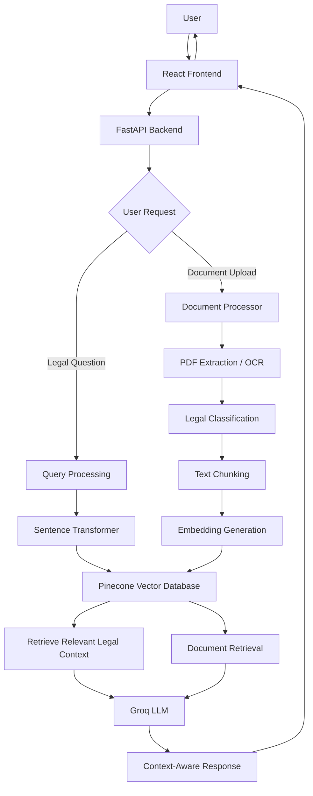
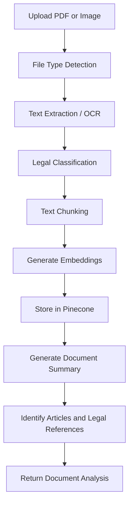
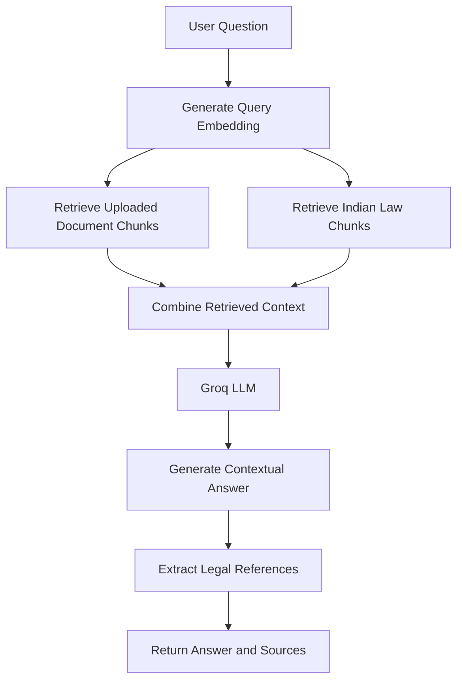

# 🇮🇳 BharathConstitu-AI
### AI-Powered Indian Constitution & Legal Intelligence Assistant

An intelligent, Retrieval-Augmented Generation (RAG) based legal assistant designed to make the Constitution of India and Indian laws easier to understand, explore, and access through natural language conversations.

---

## 1. Problem Statement

The Indian legal system consists of a vast collection of constitutional provisions, articles, amendments, acts, sections, and judicial interpretations. Understanding these legal documents is challenging for ordinary citizens, students, and individuals who do not have a legal background.

Some of the major challenges are:

- **Complex Legal Language:** Constitutional articles and legal provisions are written in technical language that is difficult for non-legal users to understand.
- **Information Overload:** Finding relevant information across hundreds of articles, sections, acts, and legal documents is time-consuming.
- **Lack of Contextual Search:** Traditional keyword-based search engines often fail to understand the actual meaning and intent behind a legal question.
- **AI Hallucinations:** General-purpose AI chatbots can generate incorrect legal information, fabricate article references, or provide misleading answers.
- **Document Analysis Difficulties:** Understanding lengthy legal PDFs, scanned documents, and legal images requires considerable time and effort.
- **Lack of Accessible Legal Guidance:** Many people struggle to understand their constitutional rights, fundamental rights, and legal protections.

There is a need for an intelligent, accessible, and context-aware system that can retrieve relevant legal information and explain it in simple language while grounding its responses in legal reference material.

## 2. Proposed Solution

**BharathConstitu-AI** is an AI-powered legal intelligence platform that uses Retrieval-Augmented Generation (RAG), semantic search, vector embeddings, and Large Language Models (LLMs) to answer questions related to the Indian Constitution and Indian laws.

Instead of relying entirely on the knowledge stored inside an LLM, the system retrieves relevant information from a dedicated legal knowledge base and provides that context to the language model before generating an answer.

The platform also supports uploading legal documents and asking questions about their contents. It combines information from uploaded documents with the existing Indian legal knowledge base to provide context-aware responses.

### Key objectives

1. Make the Indian Constitution and legal information easier to understand.
2. Enable semantic search instead of relying only on exact keyword matching.
3. Generate context-aware answers using retrieved legal information.
4. Identify relevant constitutional articles, fundamental rights, and legal references.
5. Allow users to upload and analyse their own legal documents.
6. Reduce unsupported AI-generated answers through evidence-grounded generation.
7. Provide an accessible conversational interface for exploring Indian law.

---

## 3. Key Features

### 3.1 AI-Powered Legal Question Answering

- Ask questions about the Indian Constitution and Indian legal provisions using natural language.
- Retrieve relevant legal passages using semantic similarity.
- Generate answers using the Groq LLM API.
- Explain complex legal concepts in understandable language.
- Support questions involving IPC, CrPC, BNS, BNSS, BSA, fundamental rights, and other Indian laws.

### 3.2 Retrieval-Augmented Generation (RAG)

The application uses a RAG architecture to combine information retrieval with LLM-based response generation.

- Convert legal text into meaningful chunks.
- Generate vector embeddings using Sentence Transformers.
- Store embeddings and associated metadata in Pinecone.
- Convert user questions into embeddings.
- Retrieve the most relevant legal passages using similarity search.
- Pass retrieved information to the LLM as contextual evidence.

This approach helps ground generated responses in the available legal knowledge base.

### 3.3 Legal Document Upload and Analysis

Users can upload their own legal documents for AI-powered analysis.

Supported formats:
- PDF documents.
- JPG and JPEG images.
- PNG images.
- TIFF and BMP images.
- WEBP images.

The document processing pipeline performs:

1. Document type detection.
2. Text extraction from PDFs.
3. OCR-based text extraction from images and scanned documents.
4. Identification of constitutional articles and legal references.
5. Document chunking.
6. Embedding generation.
7. Storage of document embeddings in Pinecone.
8. AI-powered document analysis.

### 3.4 Automatic Legal Document Analysis

After uploading a document, the system generates structured information, including:

- Document summary.
- Key legal points.
- Relevant constitutional articles.
- Legal references and statutes.
- Fundamental rights involved.

### 3.5 Document-Based Conversational AI

Users can ask questions specifically about their uploaded legal documents.

The hybrid RAG pipeline retrieves information from two sources:

- **Uploaded Document Knowledge:** Relevant passages from the user's uploaded document.
- **Indian Legal Knowledge Base:** Related constitutional articles and legal provisions.

The retrieved information is combined and passed to the LLM to generate a contextual response.

### 3.6 Fundamental Rights Identification

The system includes a rule-based legal classifier that identifies references to constitutional articles and maps selected articles to their associated fundamental rights and Directive Principles of State Policy (DPSPs).

Examples include:

- Article 14 – Right to Equality.
- Article 19 – Right to Freedom.
- Article 21 – Right to Life and Personal Liberty.
- Article 21A – Right to Education.
- Article 32 – Right to Constitutional Remedies.
- Article 39A – Equal Justice and Free Legal Aid.

### 3.7 Legal Source References

The RAG pipeline preserves source metadata, including document sources and legal sections, alongside retrieved context.

The document Q&A service also returns retrieved source information and similarity scores to help identify the evidence used during answer generation.

---

## 4. System Architecture

BharathConstitu-AI follows a Retrieval-Augmented Generation architecture.

### High-Level Architecture



### 4.1 Legal Knowledge Base Preparation

The legal knowledge preparation pipeline consists of:

1. Collecting Indian legal text documents.
2. Extracting and cleaning the text.
3. Identifying legal sections and provisions.
4. Dividing the content into smaller chunks.
5. Generating vector embeddings.
6. Storing embeddings and metadata in Pinecone.

### 4.2 Query Processing Pipeline

When a user submits a legal question:

1. The question is received by the FastAPI backend.
2. The system validates whether the question is related to Indian law.
3. Sentence Transformers generates an embedding for the question.
4. Pinecone performs semantic similarity search.
5. The top relevant legal passages are retrieved.
6. Retrieved passages are included in the LLM prompt.
7. Groq generates a response using the provided legal context.
8. The response and supporting source information are returned to the frontend.

### 4.3 Uploaded Document Processing Pipeline



### 4.4 Hybrid Document Question Answering



---

## 5. Technology Stack

| Layer | Technologies |
|---|---|
| Frontend | React.js, JavaScript, Vite |
| UI and Animations | Framer Motion, Lucide React |
| Backend | Python, FastAPI |
| API Server | Uvicorn |
| Generative AI | Groq API |
| LLM | Llama 3.3 70B Versatile |
| Embedding Model | Sentence Transformers |
| Model Used | all-MiniLM-L6-v2 |
| Vector Database | Pinecone |
| Semantic Search | Vector Similarity Search |
| PDF Processing | PyPDF2, pdfplumber, PyMuPDF |
| OCR | EasyOCR |
| Image Processing | Pillow |
| Data Processing | NumPy |
| Environment Management | Python dotenv |
| Version Control | Git and GitHub |

---

## 6. RAG Implementation Details

### 6.1 Embedding Generation

The project uses the Sentence Transformers model:

`sentence-transformers/all-MiniLM-L6-v2`

This model converts text into numerical vector representations that capture semantic information.

The same embedding model is used to generate representations for legal knowledge and user queries.

### 6.2 Vector Database – Pinecone

Pinecone is used to store and retrieve vector embeddings.

Each stored vector can contain metadata such as:

- Legal text.
- Source information.
- Section number.
- Section title.
- Document identifiers.
- Chunk information.

The system uses similarity-based retrieval to find legal passages relevant to the user's question.

### 6.3 Large Language Model – Groq

Groq provides the LLM inference API.

The configured model is:

`llama-3.3-70b-versatile`

The retrieved legal passages are included in the prompt so that the LLM can generate responses based on the available context.

The main RAG implementation uses a low temperature setting to encourage more consistent responses.

### 6.4 Semantic Retrieval

Unlike traditional keyword search, semantic retrieval represents questions and legal passages as vectors.

This helps retrieve relevant information even when users phrase their questions differently from the wording used in legal documents.

### 6.5 Legal Classification

A rule-based classification module identifies:

- Constitutional articles.
- Fundamental rights.
- Directive Principles of State Policy.
- Major Indian statutes.

This classification is used during document processing and response analysis.

---

## 7. Project Structure

```text
Major_project/
│
├── app/
│   └── services/
│       ├── document_processor.py
│       ├── document_rag_service.py
│       ├── ocr_processor.py
│       └── pdf_processor.py
│
├── backend/
│
├── data/
│   └── texts/
│       └── Indian legal text files
│
├── frontend/
│
├── frontend_react/
│   └── my-app/
│       ├── src/
│       ├── public/
│       ├── package.json
│       └── vite.config.js
│
├── scripts/
│
├── test/
│
├── main.py
├── rag_pipeline.py
├── rag_pipeline_extra.py
├── mistral_rag_pipeline.py
├── text_to_embeddings.py
├── pdf_to_text.py
├── groq_client.py
│
├── req.txt
├── reqs.txt
├── .gitignore
└── README.md
```

---

## 8. Installation and Setup

Follow these steps to run the project locally.

### Prerequisites

- Python 3.10 or later.
- Node.js and npm.
- Git.
- Pinecone account and API key.
- Groq account and API key.

### Step 1: Clone the Repository

```bash
git clone https://github.com/Bhaskara05/Major_project.git

cd Major_project
```

### Step 2: Set Up Python Environment

```bash
python -m venv venv
```

Activate the environment.

**Windows:**

```bash
venv\Scripts\activate
```

**macOS / Linux:**

```bash
source venv/bin/activate
```

### Step 3: Install Backend Dependencies

```bash
pip install -r req.txt
pip install -r reqs.txt
pip install groq
```

If a dependency is missing during startup, install the corresponding package listed in the error message.

### Step 4: Configure Environment Variables

Create a `.env` file in the root directory.

```env
# Groq Configuration
GROQ_API_KEY=your_groq_api_key

# Pinecone Configuration
PINECONE_API_KEY=your_pinecone_api_key
PINECONE_INDEX_NAME=your_pinecone_index_name

# Embedding Model
EMBEDDING_MODEL=sentence-transformers/all-MiniLM-L6-v2

# Document RAG Configuration
DOCUMENT_NAMESPACE=user_documents
LAW_NAMESPACE=
TOP_K_DOCUMENT=5
TOP_K_LAW=5

# Document Processing
CHUNK_SIZE=500
CHUNK_OVERLAP=100
OCR_USE_GPU=false
```

**Important:** The Pinecone index must be configured with the correct embedding dimension. The `all-MiniLM-L6-v2` model produces 384-dimensional embeddings.

Never upload your `.env` file or expose API keys in a public repository.

### Step 5: Start the Backend

From the project root directory:

```bash
uvicorn main:app --reload
```

Backend URL:

```text
http://127.0.0.1:8000
```

FastAPI interactive API documentation:

```text
http://127.0.0.1:8000/docs
```

### Step 6: Start the Frontend

Open another terminal:

```bash
cd frontend_react/my-app
```

Install dependencies:

```bash
npm install
```

Start the development server:

```bash
npm run dev
```

Vite will display the local frontend URL in the terminal.

---

## 9. Backend API Endpoints

The FastAPI backend provides the following endpoints:

| Method | Endpoint | Description |
|---|---|---|
| GET | `/` | Checks backend availability |
| POST | `/ask` | Answers Indian law-related questions |
| POST | `/upload` | Uploads and analyses legal documents |
| POST | `/document-chat` | Answers questions about uploaded documents |

### 9.1 Health Check

**Endpoint:**

```http
GET /
```

Example response:

```json
{
  "message": "Indian Laws AI Backend Running"
}
```

### 9.2 Ask Legal Questions

**Endpoint:**

```http
POST /ask
```

Request:

```json
{
  "query": "Explain Article 21 of the Indian Constitution",
  "top_k": 5
}
```

The API retrieves relevant legal context from Pinecone and generates an answer using Groq.

### 9.3 Upload Legal Documents

**Endpoint:**

```http
POST /upload
```

Content type:

```text
multipart/form-data
```

Parameter:

```text
file: document.pdf
```

The endpoint extracts document content, identifies legal references, generates a summary, and stores document embeddings for subsequent questions.

### 9.4 Document-Based Question Answering

**Endpoint:**

```http
POST /document-chat
```

Request:

```json
{
  "document_id": "generated_document_id",
  "question": "Which constitutional articles are mentioned in this document?"
}
```

The endpoint retrieves relevant chunks from the uploaded document and the Indian legal knowledge base before generating the answer.

---

## 10. Important Modules

| Module | Responsibility |
|---|---|
| `main.py` | FastAPI application and API endpoints |
| `rag_pipeline.py` | Main Indian legal RAG implementation |
| `document_rag_service.py` | Hybrid document and legal knowledge retrieval |
| `document_processor.py` | Document extraction, classification, chunking and indexing |
| `legal_classifier.py` | Identification of constitutional articles and statutes |
| `text_to_embeddings.py` | Legal text chunking, embedding generation and Pinecone indexing |
| `pdf_to_text.py` | PDF text extraction |
| `groq_client.py` | Groq API integration |

---

## 11. Advantages of the Proposed System

- **Context-Aware Responses:** Uses semantic retrieval to find relevant legal information.
- **Reduced Hallucination Risk:** Grounds LLM responses in retrieved legal context instead of relying exclusively on generated knowledge.
- **Easy Accessibility:** Allows users to ask questions in natural language.
- **Document Intelligence:** Converts lengthy legal documents into searchable information.
- **Legal Reference Identification:** Helps identify relevant constitutional articles and statutes.
- **Hybrid Retrieval:** Combines uploaded-document information with the existing legal knowledge base.
- **Modular Architecture:** Separates document processing, retrieval, classification, and response generation.

---

## 12. Future Enhancements

The following are potential improvements to extend the current implementation:

1. **Cross-Encoder Re-ranking:** Introduce a Cross-Encoder model after initial vector retrieval to improve the relevance of retrieved legal passages.

2. **Hallucination and Faithfulness Detection:** Implement an additional verification layer to evaluate whether generated answers are supported by retrieved legal evidence.

3. **Multi-LLM Comparison:** Compare responses from multiple language models based on accuracy, relevance, faithfulness, and response time.

4. **Improved Legal Citation Verification:** Validate generated article and section references against the original legal knowledge base.

5. **Multilingual Legal Assistance:** Extend support for Indian languages to make constitutional information more accessible.

6. **Advanced Search:** Combine keyword-based retrieval and semantic search through hybrid retrieval techniques.

7. **Conversation History:** Maintain conversational context for follow-up legal questions.

8. **Legal Document Comparison:** Allow users to compare multiple legal documents and identify differences in their provisions.

9. **Improved Evaluation Framework:** Introduce systematic evaluation metrics for retrieval quality, answer faithfulness, citation correctness, and latency.

---

## 13. Important Disclaimer

BharathConstitu-AI is an educational and informational AI project developed to improve access to Indian constitutional and legal information.

It does not replace qualified legal professionals, advocates, or official legal advice.

AI-generated responses may contain inaccuracies. Users should independently verify important legal information using official government publications, statutes, and qualified legal professionals before making legal decisions.

---

## 14. Project Information

**Project Name:** BharathConstitu-AI

**Domain:** Artificial Intelligence | Natural Language Processing | Legal Technology | Retrieval-Augmented Generation

**Project Type:** AI-Powered Legal Assistance Platform

**Primary Technologies:** React.js, Python, FastAPI, Sentence Transformers, Pinecone, Groq, and Llama 3.3.

**GitHub Repository:** https://github.com/Bhaskara05/Major_project

---

## 15. Author

**Bhaskara**

B.E. Computer Science and Engineering

JSS Science and Technology University, Mysuru

- GitHub: https://github.com/Bhaskara05
- LinkedIn: https://www.linkedin.com/in/bhaskara-88aa76322/

---

⭐ If you find this project interesting, consider giving the repository a star!
